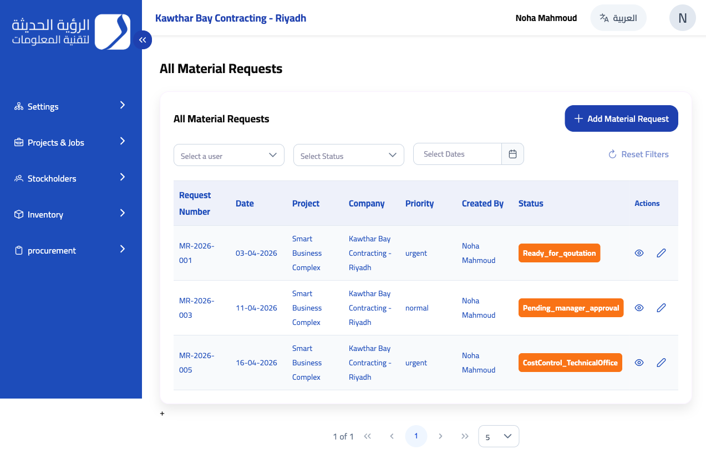
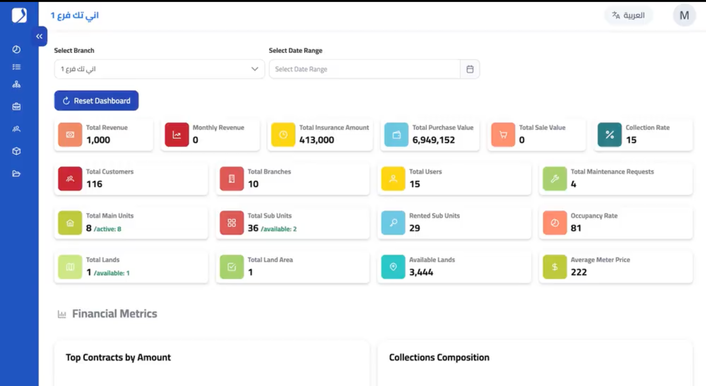
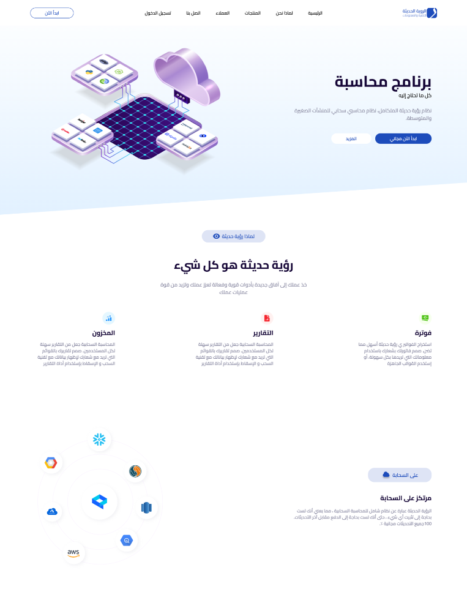
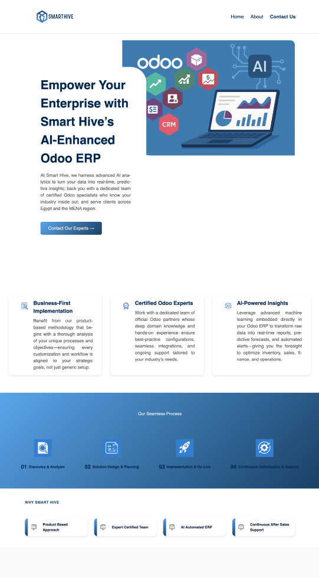

# Hi, I'm Noha! 👋

### Frontend Engineer | Web Apps, Dashboards & SaaS Platforms

I spend most of my time building web apps, figuring out complicated UI flows, and occasionally trying a new framework just because I’m curious.

💻 Angular Developer | 🧶 Crafting Enthusiast | 🧪 Framework Explorer

  
  
  

---

## ✨ A little about me

I’m a frontend engineer based in Egypt. Most of my work has been on business applications — the kind with lots of tables, filters, forms, permissions, and edge cases that never fit neatly into a screenshot.

**Angular and TypeScript** have been a big part of my work, but I don’t like sticking to one framework. I’ve also built projects with **React, Next.js, Astro, and Ionic**, and I experiment with backend tools like **Node.js and NestJS** in my own projects.

One thing I genuinely enjoy is taking a messy workflow and making it feel straightforward for the person using it. I also care about what happens after a feature ships: can someone understand the code six months later?

---
## 🛠️ Tech Stack

### Frontend

### UI & Mobile

### Backend, APIs & Tools

---

## 🚀 Featured Projects

<table>
  <tr>
    <td width="50%" valign="top">
      
      <h3>Procurement Management Web App | Angular</h3>
      

        A bilingual procurement and operations system built with Angular and TypeScript.
        I built the frontend from scratch, including material requests, approval workflows,
        quotation comparisons, purchase orders, payment vouchers, and RTL/LTR support.
      

    </td>
    <td width="50%" valign="top">
      
      <h3>Real Estate Management System | Dashboard &amp; Collections</h3>
      

        A real estate management web application with dashboards, reports, collections,
        contracts, and branch-level metrics. Built to handle day-to-day operations through
        searchable tables, reusable components, and data-driven interfaces.
      

    </td>
  </tr>
  <tr>
    <td width="50%" valign="top">
      
      <h3>Arabic SaaS Landing Page | Astro &amp; Tailwind CSS</h3>
      

        A bilingual landing page for a cloud accounting SaaS platform.
        I handled the frontend implementation, responsive layouts, and Arabic/English
        localization with RTL/LTR support.
      

    </td>
    <td width="50%" valign="top">
      
      <h3>React Landing Page with Contentful CMS | Smart Hive</h3>
      

        A responsive React and TypeScript landing page connected to Contentful CMS.
        It includes reusable components, service sections, an FAQ, client showcase,
        and a contact form built with maintainability in mind.
      

    </td>
  </tr>
</table>

---

## 💻 The kind of problems I like

A tricky form with too many states, a dashboard that needs to make sense of a lot of data, or an existing app that has become hard to change — those are the problems I enjoy untangling. I’m also happy building a small, polished landing page. Not every project needs to be huge to be interesting.

---

## 📈 GitHub Stats

  
   

  
   

---

## 📫 Let's Connect

  
  
  

